

# Biosciences: Statistical Methods

 

**Curriculum Module**

_Created with R2025a. Compatible with R2025a and later releases._

# Information

This curriculum module contains interactive [MATLAB® live scripts](https://www.mathworks.com/products/matlab/live-editor.html) that use biological data to teach fundamental concepts of statistics, data analysis, and data visualization.

## Background

You can use these live scripts as demonstrations in lectures, class activities, or interactive assignments outside class. This module will teach students how to use statistical methods in MATLAB® to analyze ecologically relevant data. We will explore the data using descriptive statistics, fit the data using a predictive model, find the linear correlations between variables, and finally, discuss how to test a hypothesis. This module utilizes the Palmer penguins \[1\] dataset, which contains data about three different species of penguin in Antarctica.

The instructions inside the live scripts will guide you through the exercises and activities. Get started with each live script by running it one section at a time. To stop running the script or a section midway (for example, when an animation is in progress), use the  Stop button in the **RUN** section of the **Live Editor** tab in the MATLAB Toolstrip.

# MATLAB Compatibility

These plain\-text live scripts require MATLAB R2025a or newer. For MATLAB R2024b or older, download the [legacy MLX version](https://github.com/MathWorks-Teaching-Resources/Biosciences-Statistical-Methods/releases/tag/mlx).

## Contact Us

Contact the [MathWorks Educator Content Development Team](mailto:onlineteaching@mathworks.com) if you would like to request assistance, provide feedback, or if you have a question.

## Prerequisites

This module assumes you're familiar with the basics of using MATLAB by going through the [MATLAB Onramp](https://matlabacademy.mathworks.com/details/matlab-onramp/gettingstarted) before continuing. We also recommend reviewing the [Biosciences: Working with Data](https://www.mathworks.com/matlabcentral/fileexchange/181586-biosciences-working-with-data) courseware.

## Getting Started

### Accessing the Module

### **On MATLAB® Online**™:

Use the  link to download the module. You will be prompted to log in or create a MathWorks account. The project will be loaded, and you will see an app with several navigation options to get you started.

### **On Desktop:**

Download or clone this repository. Open MATLAB, navigate to the folder containing these scripts and double\-click on [BiosciencesStatisticalMethods.prj](<matlab: openProject("BiosciencesStatisticalMethods.prj")>). It will add the appropriate files to your MATLAB path and open an app that asks you where you would like to start.

Ensure you have all the required products ([listed below](#H_E850B4FF)) installed. If you need to include a product, add it using the Add\-On Explorer. To install an add\-on, go to the **Home** tab and select   **Add-Ons** > **Get Add-Ons**. 

## Products

MATLAB® is used throughout. Tools from the Curve Fitting Toolbox™ and the Statistics and Machine Learning Toolbox™ are used frequently as well.

# Scripts

## [S1LoadCleanData.m](https://matlab.mathworks.com/open/github/v1?repo=MathWorks-Teaching-Resources/Biosciences-Statistical-Methods&project=BiosciencesStatisticalMethods.prj&file=Scripts/S1LoadCleanData.m) 
||||
| :-- | :-- | :-- |
| 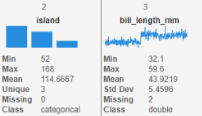    | **In this script, students will...**   $\bullet$ clean data and prepare a dataset for analysis    | **Academic disciplines**   $\bullet$ Biology     |

## [S2ExploringData.m](Scripts/S2ExploringData.m) 
||||
| :-- | :-- | :-- |
| 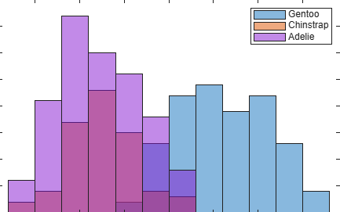    | **In this script, students will...**   $\bullet$ visualize data   $\bullet$ create and filter tables    | **Academic disciplines**   $\bullet$ Biology     |

## [S3DescriptiveStatistics.m](Scripts/S3DescriptiveStatistics.m) 
||||
| :-- | :-- | :-- |
| 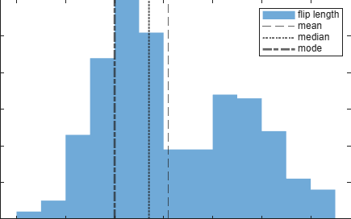    | **In this script, students will...**   $\bullet$ calculate and visualize descriptive statistics including mean, median, mode, standard deviation, and range    | **Academic disciplines**   $\bullet$ Biology     |

## [S4PredictiveModeling.m](Scripts/S4PredictiveModeling.m) 
||||
| :-- | :-- | :-- |
| 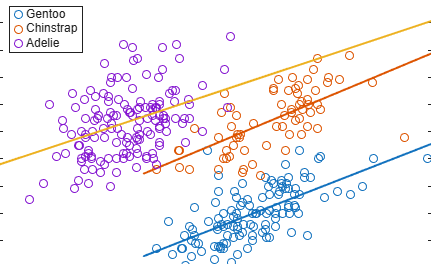    | **In this script, students will...**   $\bullet$ calculate and visualize linear regression lines   $\bullet$ consider goodness of fit metrics and how to avoid overfitting    | **Academic disciplines**   $\bullet$ Biology     |

## [S5Correlations.m](Scripts/S5Correlations.m)
||||
| :-- | :-- | :-- |
| 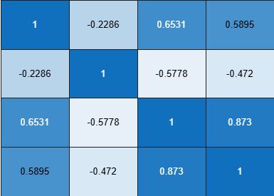    | **In this script, students will...**   $\bullet$ compute and visualize correlation coefficients   $\bullet$ analyze the strength of a correlation and consider what it means for a biological dataset    | **Academic disciplines**   $\bullet$ Biology     |

## [S6HypothesisTesting.m](Scripts/S6HypothesisTesting.m) 
||||
| :-- | :-- | :-- |
| 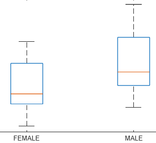    | **In this script, students will...**   $\bullet$ develop null and alternate hypotheses   $\bullet$ visualize a hypothesis with a box\-and\-whisker plot   $\bullet$ run a hypothesis test     | **Academic disciplines**   $\bullet$ Biology     |

## [S7ProblemSet.m](Scripts/S7ProblemSet.m) 
||||
| :-- | :-- | :-- |
| 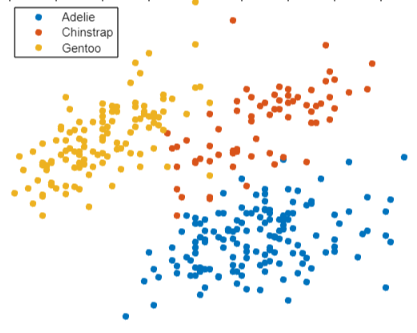    | **In this script, students will...**   $\bullet$ create scatter and box\-and\-whisker plots to analyze data   $\bullet$ use hypothesis testing to determine whether a claim is statistically significant    | **Academic disciplines**   $\bullet$ Biology     |

# License

The license for this module is available in the [LICENSE.md](https://github.com/MathWorks-Teaching-Resources/Biosciences-Statistical-Methods/blob/release/LICENSE.md).

# Related Courseware Modules

| **Courseware**    |  | **Location**     |
| :-- | :-- | :-- |
| [Biosciences: Working With Data](https://www.mathworks.com/matlabcentral/fileexchange/181586-biosciences-working-with-data)     | 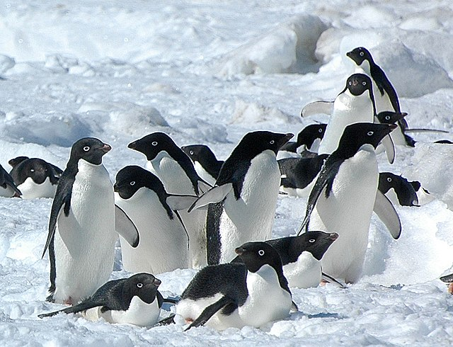    | **Available on:**          [GitHub](https://github.com/MathWorks-Teaching-Resources/Biosciences-Working-With-Data)      |
| [Biosciences: Image Processing](https://www.mathworks.com/matlabcentral/fileexchange/163701-biosciences-image-processing)     | 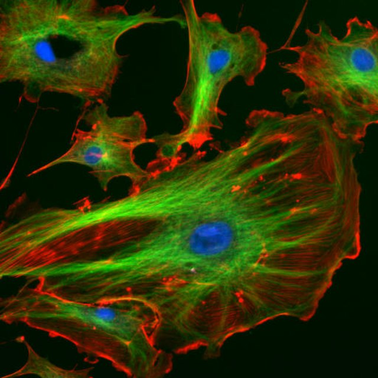    | **Available on:**          [GitHub](https://github.com/MathWorks-Teaching-Resources/Biosciences-Image-Processing)      |
| [Biosciences: Machine Learning](https://www.mathworks.com/matlabcentral/fileexchange/163696-machine-learning-for-biosciences)     |  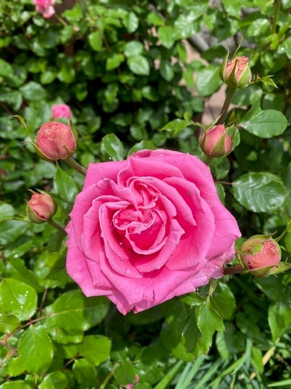    | **Available on:**          [GitHub](https://github.com/MathWorks-Teaching-Resources/Biosciences-Machine-Learning)      |
| [Biosciences: Genetics](https://www.mathworks.com/matlabcentral/fileexchange/163706-biosciences-genetics)     |  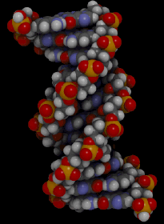    | **Available on:**          [GitHub](https://github.com/MathWorks-Teaching-Resources/Biosciences-Genetics)      |

Or feel free to explore our other [modular courseware content](https://www.mathworks.com/matlabcentral/fileexchange/?q=tag%3A%22courseware+module%22&sort=downloads_desc_30d).

# Educator Resources
- [Educator Page](https://www.mathworks.com/academia/educators.html)
- [Instructor Resources](<matlab: InstructorResources>)

# Contribute 

Looking for more? Find an issue? Have a suggestion? Please contact the [MathWorks Educator Content Development Team](mailto:onlineteaching@mathworks.com). If you want to contribute directly to this project, you can find information about how to do so in the [CONTRIBUTING.md](CONTRIBUTING.md) page on GitHub.

# Citations

\[1\] Horst AM, Hill AP, Gorman KB (2020). palmerpenguins: Palmer Archipelago (Antarctica) penguin data. R package version 0.1.0. [https://allisonhorst.github.io/palmerpenguins/](https://allisonhorst.github.io/palmerpenguins/). doi:10.5281/zenodo.3960218.

# Help us Improve

[Share your feedback](<matlab: ShareFeedback>) to help us improve this module.

*©* Copyright 2023\-2026 The MathWorks, Inc
